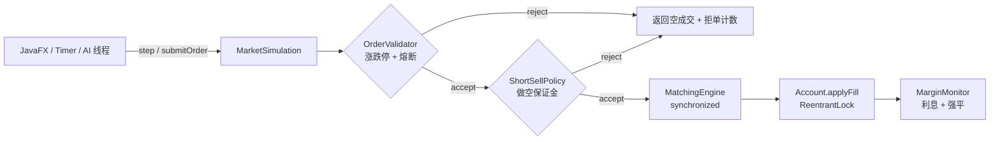
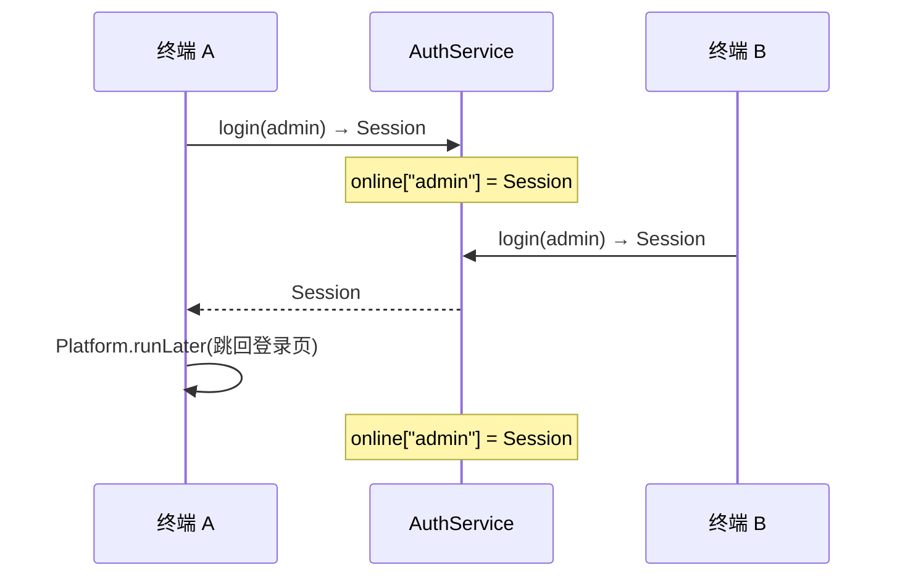
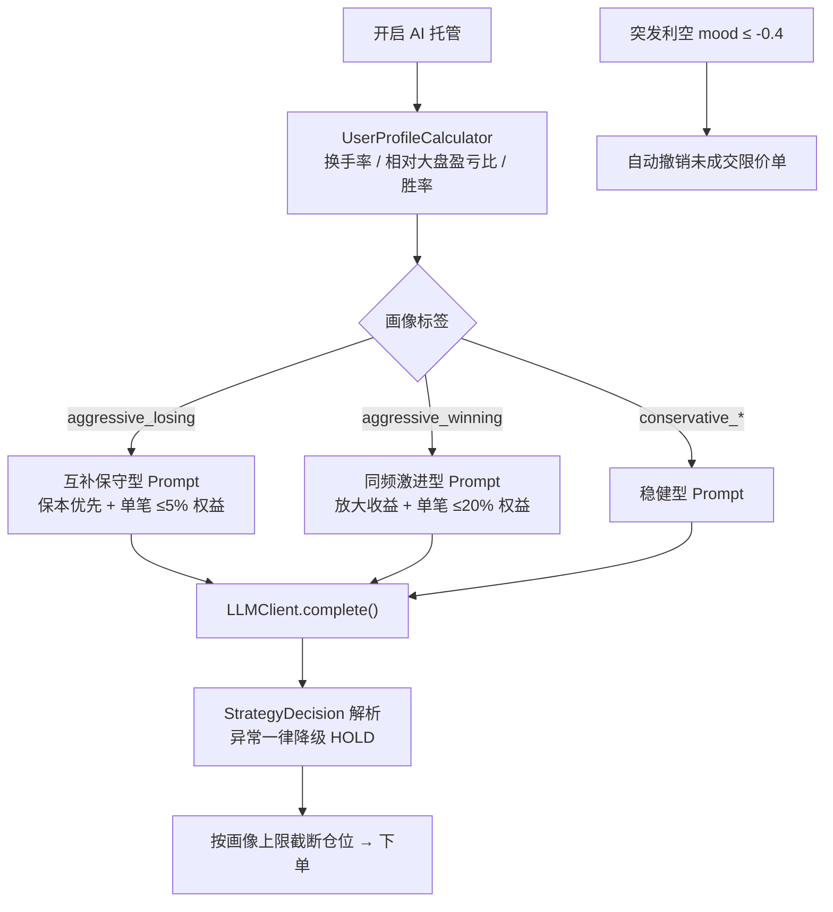

# MultiAgentTradingSimulation — 多智能体智能金融市场模拟平台

Java 课程项目。本项目不仅是股票交易模拟器，而是一个结合**订单驱动市场、多智能体 AI 决策、风控与大模型投顾**的实验平台：通过不同的 AI 交易策略、市场机制与风险控制模型，研究智能体如何影响市场价格形成，以及不同交易策略在不同市场环境中的表现。

---

## 目录

- [功能特性](#功能特性)
- [快速开始](#快速开始)
- [项目结构](#项目结构)
- [三大扩展模块](#三大扩展模块)
- [实验设计](#实验设计)
- [测试](#测试)
- [设计说明](#设计说明)

---

## 功能特性

### 核心交易层

| 创新点 | 实现位置 |
| --- | --- |
| 核心撮合引擎 | `engine/` — 价格优先 + 时间优先撮合，支持 **LIMIT / MARKET / STOP / IOC / ICEBERG** 五种订单类型 |
| 交易成本模型 | `risk/FeeCalculator`（双边 0.1%）+ `risk/SlippageModel`（虚拟深度滑点） |
| 多智能体 AI 交易比赛 | `Momentum`（趋势）/ `Value`（价值）/ `HFT`（高频）/ `MarketMaker`（做市商）同场竞技 |
| 实时控制台 Dashboard | `simulation/Dashboard` — 每 N 期输出排名与净值（不再是纸面描述） |
| AI 辩论决策机制 | `ai/` — BullAgent / BearAgent 陈述证据，JudgeAgent 仲裁后执行 |
| 新闻情绪分析 | `market/` — NewsEngine 发布新闻，情绪分析器打分并影响价格漂移与**全部**交易路径 |
| 可解释 AI | 每个 AI 每次决策记录动作/置信度/理由；每笔成交记录归因原因，按实验落盘 CSV |

### 扩展层（本次重构新增）

| 模块 | 能力 |
| --- | --- |
| 模块一 引擎重构 | 主循环解耦为 `step()` / `start()` / `submitOrder()` 公共 API；Scanner 输入隔离为 `CommandSource`；撮合与账户并发加锁；做空 + 保证金 + 强平；涨跌停 + 熔断 `OrderValidator`；`SentimentAnalyzer` 抽接口并支持 LLM 实现 |
| 模块二 JavaFX 前端 | 登录 + SSO 单点互踢（`ConcurrentHashMap<String, Session>`）、管理员控制台（人工新闻 / 60 秒定时随机新闻 / 全市场监控 / 订单簿深度）、用户终端（实时行情 + 折线图 + 五档盘口 + 下单 + 账户 + CSV 导出 + 只读新闻栏 + AI 托管开关） |
| 模块三 LLM 智能投顾 | 用户画像（换手率 / 相对大盘盈亏比 → 四类标签）、按画像动态改写 System Prompt、保守/激进策略匹配、突发利空自动撤单，`MockLLMClient` 离线可演示，`HttpLLMClient` 接真实 API |

---

## 快速开始

### 前置条件

| 项 | 要求 | 本机现状 |
| --- | --- | --- |
| JDK | **25 及以上**（项目以 Java 25 编译并运行） | PATH 里的 `java -version` 是 **1.8.0_301，太旧**，必须显式指定 JDK 目录 |
| Maven | 可选 | **未安装**，所以下文以 `javac/java` 直接编译为主 |
| JavaFX | 仅 GUI 需要 | 需执行一次下面的下载脚本，jar 落在 `lib/` |

### 步骤 0：下载 JavaFX 依赖（只需一次）

```powershell
# 在项目根目录执行
.\scripts\download-javafx.ps1
```

脚本会把 `javafx-base / javafx-graphics / javafx-controls`（含 Windows 平台 native）共 6 个 jar 下载到 `lib/`。
`lib/*.jar` 已在 `.gitignore` 中忽略，换机器时重新执行脚本即可。

### 编码问题（Windows 必看）

Windows 系统 ANSI 代码页是 **GB2312**。当 `java` 的 stdout 被管道/重定向时，JVM 会用
`native.encoding`（GB2312）输出字节，而终端按 UTF-8 解码 → **中文全乱码**。

> ⚠️ 常见的 `-Dfile.encoding=UTF-8` **对 stdout 无效**（已实测：加与不加输出的都是 GB2312 字节）。
> 必须显式指定 `-Dstdout.encoding=UTF-8 -Dstderr.encoding=UTF-8`（JDK 19+）。

### 方式一：`scripts\run.ps1`（推荐，一条命令搞定乱码 + JDK + 编码）

```powershell
# 编译
.\scripts\run.ps1 build

# 三个实验 + 可解释 AI 样本
.\scripts\run.ps1

# 核心引擎单元测试（56 断言）
.\scripts\run.ps1 test

# 端到端冒烟测试
.\scripts\run.ps1 smoke

# 高级功能演示测试（31 断言）
.\scripts\run.ps1 innovation

# 人机交互模式
.\scripts\run.ps1 human

# JavaFX 图形界面（自动带 --module-path）
.\scripts\run.ps1 gui

# 同时把输出写成 UTF-8 日志 target\run.log
.\scripts\run.ps1 main -Log
```

脚本行为：自动探测 **JDK ≥ 25**（会跳过 PATH 里的 1.8，找到 VS Code 内置的 Temurin-25）、
把控制台切到 `chcp 65001`、给 JVM 加上 `-Dstdout.encoding=UTF-8 -Dstderr.encoding=UTF-8`。
若本机没有任何 JDK 25+：`.\scripts\run.ps1 -Jdk 'C:\Program Files\Java\jdk-25'`。

### 方式二：PowerShell + 原生 javac（想手动控制时用）

把下面整段粘到 PowerShell（在项目根目录执行）：

```powershell
# 0) 指定 JDK（示例用 VS Code 自带的 Temurin-25）
$JDK = "C:\Users\gr1na\.vscode\extensions\redhat.java-1.58.0-win32-x64\jre\25.0.4.1-win32-x86_64"

# 依赖 classpath（必须先执行过 scripts\download-javafx.ps1）
$CP = (Get-ChildItem lib -Filter *.jar | ForEach-Object { $_.FullName }) -join ';'

# 1) 编译全部源码（含 GUI）
$SRC = Get-ChildItem -Path src -Recurse -Filter *.java | ForEach-Object { $_.FullName }
& "$JDK\bin\javac.exe" -encoding UTF-8 -Xlint:all -cp "$CP" -d target/classes $SRC

# 2) 让 JVM 以 UTF-8 输出（解决中文乱码；-Dfile.encoding 对 stdout 无效，必须用它俩）
$JVMPARAM = "-Dfile.encoding=UTF-8", "-Dstdout.encoding=UTF-8", "-Dstderr.encoding=UTF-8"

# 3) 运行：三个实验 + 可解释 AI 样本
& "$JDK\bin\java.exe" $JVMPARAM -cp "target/classes;$CP" com.trading.Main

# 4) 单元测试（56 个断言）
& "$JDK\bin\java.exe" $JVMPARAM -cp "target/classes;$CP" com.trading.test.CoreEngineTest

# 5) 端到端冒烟测试（含情绪开关对照组、风控场景）
& "$JDK\bin\java.exe" $JVMPARAM -cp "target/classes;$CP" com.trading.test.SimulationSmokeTest

# 6) 高级功能演示测试（31 个断言）
& "$JDK\bin\java.exe" $JVMPARAM -cp "target/classes;$CP" com.trading.test.InnovationDemoTest

# 7) 人机交互模式
& "$JDK\bin\java.exe" $JVMPARAM -cp "target/classes;$CP" com.trading.Main --human
```

> 只想跑核心引擎、不想下 JavaFX？把编译命令里的 `-cp "$CP"` 去掉、并过滤掉 `ui` 包即可：
> `$SRC = Get-ChildItem -Path src -Recurse -Filter *.java | Where-Object { $_.FullName -notmatch '\\ui\\' } | ForEach-Object { $_.FullName }`

### 方式三：启动 JavaFX 图形界面（或 `.\scripts\run.ps1 gui`）

> ⚠️ JavaFX 应用**必须用 `--module-path` 启动**。只用 `-cp` 会报
> `缺少 JavaFX 运行时组件，需要使用该组件来运行此应用程序`。

```powershell
$JDK = "C:\Users\gr1na\.vscode\extensions\redhat.java-1.58.0-win32-x64\jre\25.0.4.1-win32-x86_64"
$MP  = (Get-ChildItem lib -Filter *.jar | ForEach-Object { $_.FullName }) -join ';'

& "$JDK\bin\java.exe" "-Dfile.encoding=UTF-8" "-Dstdout.encoding=UTF-8" "-Dstderr.encoding=UTF-8" `
    --module-path "$MP" --add-modules javafx.controls `
    --enable-native-access=javafx.graphics `
    -cp target/classes com.trading.ui.TradingPlatformApplication
```

（`--enable-native-access` 用来消除 JDK 24+ 的 native access 警告。）

### 方式四：VS Code（已配置好，开箱即用）

仓库已提供 `.vscode/settings.json`（把 `lib/**/*.jar` 加入工程 classpath，自动消除编辑器红叉）
和 `.vscode/launch.json`（可直接 Run Main）。打开项目 → Reload Window → 左侧「运行和调试」选 **Run Main**。

### 方式五：Maven（需先自行安装 Maven）

```bash
mvn -q clean compile
mvn exec:java -Dexec.mainClass=com.trading.Main
mvn javafx:run
```

演示账号：

| 账号 | 密码 | 角色 | 权限 |
| --- | --- | --- | --- |
| `admin` | `admin123` | 管理员 | 发布新闻、开关随机新闻、查看全市场监控 |
| `trader` | `trader123` | 普通用户 | 行情查看、下单、撤单、导出 CSV、AI 托管 |
| `Alice` | `alice123` | 普通用户 | 同上 |

---

## 项目结构

```
src/main/java/com/trading/
├── Main.java                  # 入口：三个实验 / --human / --gui
├── model/                     # 金融对象
│   ├── Order.java             #   订单（五种类型，冰山/止损参数）
│   ├── Trade.java             #   成交记录（含成交归因 reason）
│   ├── Decision.java          #   AI 决策记录（动作/数量/置信度/理由/决策时价格）
│   ├── Side / OrderType / Action
├── engine/                    # 交易逻辑
│   ├── OrderBook.java         #   订单簿：价格优先 + 时间优先（并发安全）
│   ├── MatchingEngine.java    #   撮合：撮合锁、风控拦截、做空校验、虚拟深度
│   └── ShortSellPolicy.java   #   做空策略扩展点
├── account/                   # 账户体系
│   ├── Account.java           #   现金/持仓/均价/已实现盈亏/手续费/空头/保证金（并发安全）
│   ├── ShortSellingMode.java  #   LEGACY / MARGIN / DISABLED
│   ├── MarginShortSellPolicy.java  # 做空保证金校验与记账
│   └── MarginMonitor.java     #   借券利息计提与强制平仓
├── agent/                     # 交易者
│   ├── TraderAgent.java / TradingApi.java   # 双接口解耦
│   ├── MarketSnapshot.java    #   行情快照（含受控的情绪信号）
│   ├── CommandSource.java / ScannerCommandSource.java / QueueCommandSource.java
│   ├── HumanTrader.java       #   人类交易者（输入源可替换）
│   ├── MomentumTrader / ValueTrader / HighFrequencyTrader / MarketMakerAgent
│   ├── DebateTrader.java      #   辩论交易者
│   ├── AiCustodyAgent.java    #   LLM 投顾：画像 + 动态 Prompt + 自动撤单
│   ├── UserTerminalAgent.java #   人工 ↔ AI 托管切换
│   └── DecisionLog.java       #   按实验分文件的 CSV 日志
├── ai/                        # 多 Agent 辩论系统
│   ├── BullAgent / BearAgent / JudgeAgent / DebateSystem / Opinion
├── market/                    # 市场数据
│   ├── SentimentAnalyzer.java       # 接口（可插拔）
│   ├── KeywordSentimentAnalyzer.java # 关键词规则实现（默认）
│   ├── NewsEngine.java              # 随机发布 + 人工注入 + 监听器推送
│   ├── NewsListener.java / NewsItem.java / PriceHistory.java
├── risk/                      # 风险模型
│   ├── FeeCalculator.java     #   手续费（0.1%，双边）
│   ├── SlippageModel.java     #   虚拟深度定价（撮合路径）
│   ├── SlippageEstimator.java #   订单簿行走估算（非撮合路径）
│   ├── PriceLimitRule.java    #   涨跌停板（±10% 拒单）
│   ├── CircuitBreaker.java    #   熔断（窗口内跌 5% 暂停交易）
│   ├── OrderValidator.java / DefaultRiskController.java / ValidationResult.java / MarketContext.java
├── simulation/                # 仿真框架
│   ├── MarketSimulation.java  #   主循环 + 对外 step()/start()/submitOrder() API
│   ├── Dashboard.java         #   每 N 期控制台实时排名
│   ├── SimulationConfig.java  #   参数集中配置（可复现实验）
│   └── PerformanceTracker.java #  净值序列/收益率/最大回撤/排名
├── llm/                       # 大模型适配（模块三）
│   ├── LLMClient.java         #   统一接口（离线/在线可替换）
│   ├── MockLLMClient.java     #   本地确定性实现（默认，无需 Key）
│   ├── HttpLLMClient.java     #   OpenAI 兼容协议实现（环境变量注入 Key）
│   ├── LlmSentimentAnalyzer.java # SentimentAnalyzer 的 LLM 实现
│   ├── PromptBuilder.java     #   按画像动态生成 System Prompt
│   └── StrategyDecision.java  #   模型输出协议解析
├── profile/                   # 用户画像（模块三）
│   ├── ProfileTag.java / UserProfile.java / UserProfileCalculator.java
├── auth/                      # 权限系统（模块二）
│   ├── AuthService.java       #   登录/互踢/角色鉴权（ConcurrentHashMap 会话表）
│   ├── Session.java / User.java / Role.java
├── ui/                        # JavaFX 前端（模块二）
│   ├── TradingPlatformApplication.java  # 应用外壳：仿真装配、时钟、权限入口
│   ├── LoginView.java / AdminConsoleView.java / UserTerminalView.java
└── test/
    ├── CoreEngineTest.java    #   核心引擎单元测试（56 个断言）
    ├── SimulationSmokeTest.java # 端到端冒烟测试（含情绪开关对照与风控场景）
    ├── InnovationDemoTest.java  # 高级功能演示测试
    └── SimulationMain.java    #   入门演示
```

---

## 三大扩展模块

### 模块一：底层引擎适配性重构



- **接口暴露**：`MarketSimulation` 提供 `start()` / `step(tick)` / `submitOrder()` / `cancelOrder()` / `injectNews()`，`TradingPlatformApplication` 用 JavaFX `Timeline` 每秒推进一期
- **输入隔离**：控制台 `Scanner` 被抽到 `ScannerCommandSource`；GUI 使用非阻塞的 `QueueCommandSource`，彻底消除主循环被 `Scanner` 卡住的风险
- **并发安全**：`MatchingEngine` 全局锁保护「取最优档 → 成交 → 减仓」复合操作；`Account` 用 `ReentrantLock` 保护余额/持仓；`OrderBook` 方法同步
- **做空**：`Account` 增加 `shortPosition` / `borrowedShares` / `margin` / `loanInterest`；三种模式见 `ShortSellingMode`（默认 `LEGACY` 以保持历史实验逐比特可复现）
- **风控**：委托价超出参考价 ±10% 拒单；窗口内跌幅 ≥5% 触发熔断并暂停交易。离线实验按「仿真期数」计时，GUI 实时模式可切换为真实毫秒计时

### 模块二：JavaFX 前端与权限系统



- **互踢**：`ConcurrentHashMap<String, Session>` 维护在线状态，二次登录使旧会话失效并触发 UI 回调跳回登录界面
- **鉴权**：管理员专属操作统一走 `AuthService.requireAdmin(session)`，普通用户即使绕过 UI 也无法发布新闻
- **管理员控制台**：新闻输入框 + 发布按钮、`java.util.Timer` 每 60 秒随机新闻开关、全市场资产监控、买卖五档深度
- **用户终端**：`LineChart` 实时折线图、五档盘口、限价/市价下单、撤单、账户面板、CSV 导出、只读新闻栏、AI 托管开关

### 模块三：LLM 智能投顾与用户画像



- **画像**：`UserProfileCalculator` 从历史决策与账户状态计算换手率、平均单笔额、相对大盘盈亏比、胜率，生成四类标签
- **动态 Prompt**：`PromptBuilder` 按标签改写 System Prompt；用户侧 User Prompt 为结构化 `KEY=value`，本地 Mock 也能解析，实现离线演示
- **自动撤单**：识别到突发利空（情绪 ≤ -0.4）时撤销该用户未成交的限价单，止损单保留以维持风控保护
- **LLM 可插拔**：默认 `MockLLMClient`（确定性、离线）；配置 `LLM_API_KEY` / `LLM_BASE_URL` / `LLM_MODEL` 后自动切换 `HttpLLMClient`，无需改动任何调用方代码

---

## 实验设计

> 以下数值均由本机实际运行生成（JDK 25 + 当前代码 + seed=42），固定随机种子因此完全可复现。
> 复现命令见「快速开始 · 方式一」第 2 步。

### 实验 1：AI 策略竞赛（300 期，初始资金 $100,000，seed=42）

| Rank | Strategy | Final Equity | Return | MaxDrawdown | Realized PnL | Fees | Trades | 说明 |
| --- | --- | --- | --- | --- | --- | --- | --- | --- |
| 1 | MarketMaker | $107,102.33 | **+7.10%** | 10.74% | $3,135.13 | $397.55 | 247 | 靠双边报价吃价差，是唯一显著盈利的策略；但杠杆式空头敞口带来 10.74% 回撤 |
| 2 | HFTrader | $99,070.81 | -0.93% | 1.29% | $-483.63 | $18.04 | 28 | 交易次数最少，几乎被双边手续费吃掉潜在收益 |
| 3 | ValueTrader | $98,969.41 | -1.03% | 2.13% | $-998.87 | $31.72 | 18 | 只在极端偏离时出手，交易频率最低 |
| 4 | DebateTrader | $98,319.60 | -1.68% | 5.89% | $196.40 | $142.69 | 148 | 毛收益为正（$196.40），但 148 笔成交的手续费 $142.69 使其净收益转负 |
| 5 | MomentumTrader | $91,532.62 | -8.47% | 21.66% | $-2,275.68 | $291.54 | 146 | 追涨杀跌叠加双边收费，回撤最大，垫底 |

**市场统计**：期末价 135.45 | 价格波动率 1.52% | 平均价差 0.04 | 总成交量 3203 股
**风控统计**：拒单 265 笔 | 强制平仓 0 次 | 熔断 8 次 | 借券利息 $240.20

结论读数：在「双边收费 + 熔断限制」的市场里，**交易频率本身就是最大的成本**——
成交笔数最少的 HFTrader/ValueTrader 反而跑赢了高频出手的 Momentum/Debate；
唯一能覆盖成本的是靠提供流动性赚钱的 MarketMaker。

排行榜即时（每 50 期刷新一次）与最终名次均由 `Dashboard` / `PerformanceTracker` 输出；
每个策略的决策理由可在 `data/exp1-competition_decision_log.csv` 中逐条追溯。

### 实验 2：加入做市商前后对比（同一随机种子）

| 指标 | 无做市商 | 有做市商 | 变化 |
| --- | --- | --- | --- |
| 簿内平均价差 | N/A（无双边报价） | **0.04** | 无做市商时簿内没有双边报价，价格发现无从谈起 |
| 隐性价差 | 0.20 | 0.20 | +0.00%（两组共用同一虚拟深度模型 `2 × slippagePerLevel`） |
| 总成交量 | 2066 股 | 2272 股 | **+10.0%** |
| 价格波动率 | 1.52% | 1.52% | +0.00%（价格过程外生，订单流不反作用于价格） |
| 主动方平均收益 | -3.68% | -3.40% | **+0.28 个百分点** |
| 拒单数 | 90 笔 | 218 笔 | 做市商持续双边挂单，触碰涨跌停/熔断拒单的概率更高 |

**做市商自身业绩**：收益率 +9.29% | 已实现盈亏 $3,599.68 | 手续费 $318.53 | 成交 164 笔

结论读数：加入做市商后**成交量 +10%、主动方平均收益 +0.28 个百分点**，而价格波动率不变
（因为价格过程外生）。这正是「提供流动性 → 降低隐性交易成本 → 做大成交量」的教科书结论，
且由代码实时算出，不再是写死的文案：`Main.printExperiment2` 中的
`volumeChange` / `volatilityChange` / `takerReturnChange`。

### 实验 3：AI 辩论 vs 单一 AI

| Strategy | Return | MaxDrawdown | Risk-Adjusted（Return / Drawdown） |
| --- | --- | --- | --- |
| HFTrader | -0.93% | 1.29% | -0.72 |
| ValueTrader | -1.03% | 2.13% | -0.48 |
| **DebateTrader** | **-1.68%** | 5.89% | -0.29 |
| MomentumTrader | -8.47% | 21.66% | -0.39 |

辩论系统让 AI 不直接交易：Bull 与 Bear 分别陈述证据，Judge 仲裁后才执行。
相比单一 AI 的黑盒决策，决策日志可完整追溯每次交易的推理链——
本实验中 DebateTrader **毛收益为正**（$196.40）而净利润为负，清晰地暴露出
「辩论提高了决策质量，但没有约束交易频率，手续费是唯一的拖累」，
这本身就是一个有说服力的研究结论。

### 实验 4（新增）：情绪开关对照组

`SimulationConfig.sentimentAffectsStrategies = false` 可把情绪对策略的影响整体关闭，
得到一个干净的技术面对照组，用于量化「新闻情绪究竟带来多少超额/折损」（冒烟测试已内置该场景）。

---

## 测试

| 测试 | 内容 | 实际结果 |
| --- | --- | --- |
| `CoreEngineTest` | 作业要求的 4 个场景（买卖成交 / 多订单排序 / 部分成交 / 无法成交）+ 卖单主动成交、市价单、IOC、止损、冰山、手续费、滑点估算、账户盈亏 | **56 通过 / 0 失败** |
| `SimulationSmokeTest` | 端到端 5 Agent 仿真 + 做市商前后对比 + 情绪开关对照组 + 风控场景 | 全部通过 |
| `InnovationDemoTest` | 涨跌停 / 熔断 / 情绪分析插拔 / LLM 决策协议 / 用户画像标签 / AI 自动撤单 | **31 通过 / 0 失败** |

构建基线：`javac -encoding UTF-8 -Xlint:all` 全量编译 **75 个源文件 → 85 个 class，0 error、0 warning**；
JavaFX GUI 已实测可正常启动（`--module-path` 方式）。

---

## 设计说明

- **AI 无外部依赖**：技术面策略、辩论系统、`MockLLMClient` 与默认关键词情绪分析全部为规则实现，离线可运行、结果可复现；仅 `HttpLLMClient` 需要配置密钥且故障时自动降级为 HOLD
- **价格过程**：随机游走 + 新闻冲击 + 情绪漂移，按 0.01 最小变动价位取整；**订单流不会反作用于价格**（外生价格过程），这是研究策略相对表现的前提，也已在实验 2 中显式标注
- **冰山单简化**：切片成交后自动补充，不做队尾重排（真实交易所会重排，作为未来扩展点）
- **成交归因**：每笔成交都带 `reason`（`aggressor crossed the spread` / `stop-loss triggered` / `slippage: virtual level N`），使执行层同样可解释
- **日志分实验**：一次 `Main` 运行会产生 3 个 `MarketSimulation`，各自写入 `<experiment>_decision_log.csv` 与 `<experiment>_trade_log.csv`，并在首列标注实验名，避免 tick 重复无法区分来源
- **确定性**：全部实验使用固定随机种子，且并发层的加锁只做串行化、不改变判定顺序，因此多线程驱动下结果依然稳定

## 已知限制

- `data/` 目录追加写：重复运行会累积历史记录，需要对照特定实验时建议先清空该目录
- 熔断在离线模式下按「仿真期数」计时（`circuitBreakerHaltTicks`），如需真实 1 分钟语义请设置 `realTimeHalt = true`
- 做空默认为 `LEGACY` 模式（与历史实验一致），研究保证金/强平时请显式设置 `shortSellingEnabled = true`
